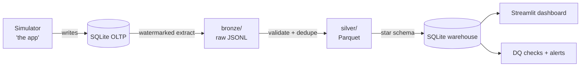

# RideFlow 🚕

<!-- Replace USERNAME with your GitHub handle after the first push. -->
[](https://github.com/USERNAME/rideflow/actions/workflows/ci.yml)

A ride-hailing analytics platform built with a **zero-install data engineering stack**:
SQLite (OLTP + warehouse), Parquet data lake (pyarrow), pydantic data contracts,
a custom DAG orchestrator, and a Streamlit dashboard — all pure Python.

## Architecture



## Quickstart

```bash
python -m rideflow.simulator.engine --days 7 --reset   # generate a week of rides
python -m rideflow.orchestrator run                    # bronze → silver → gold → DQ gate
python -m rideflow.orchestrator run                   # again: incremental (near no-op)
python -m rideflow.orchestrator run --backfill         # full reload, identical results
python -m rideflow.orchestrator status                 # run + task history
python -m rideflow.pipeline.dq run                     # data quality checks (standalone)
python -m rideflow.pipeline.dq history                 # DQ results over time
streamlit run rideflow/dashboard.py                    # analytics on the warehouse
```

The dashboard has two views (sidebar): **Warehouse** — revenue, zone and driver
analytics from the gold star schema, lifecycle funnel, and the DQ monitoring tab
(pass/warn/fail per run + full incident history); **Simulator** — the raw OLTP
source for debugging the generator.

## Pipeline layers

| Layer | Format | Guarantee |
|---|---|---|
| bronze | JSONL, append-only, partitioned by ingestion date | raw & immutable — exactly what the source returned |
| silver | Parquet, compacted per (table, event date) | contract-validated (pydantic), deduped by PK, quarantine for rejects |
| gold | SQLite star schema | PK-upsert facts, rebuilt small dims, joins zone/date/user/driver |

Incremental correctness comes from **watermarks** (high-water mark minus a lookback
window for late-landing rows), a **processed-file ledger** (crashed runs replay
their bronze batches), and **idempotent materialization** (backfills are
byte-identical). Every run, task, attempt, and watermark lives in `data/state.db`.

## Data quality

A 13-check suite gates every pipeline run (`dq_gate` task — a failing check
fails the run after retries; `--no-strict` downgrades to record-only):

| Category | Checks |
|---|---|
| source ↔ gold reconciliation | rides, payments (count + revenue to the cent), events |
| gold integrity | PK uniqueness, payments→rides FK, rides→dims FK, status domain, surge range |
| freshness & volume | newest-ride lag, last-full-day volume vs 7-day mean |
| distribution health | failed-payment share, cancellation share |
| silver health | quarantine rate of the latest run |

Results land in `state.dq_results` with full history —
`python -m rideflow.pipeline.dq history` shows the trend.

## Testing

```bash
pip install -r requirements.txt -r requirements-dev.txt
python -m pytest tests -v
```

19 tests run the entire system against per-test temp directories (nothing
touches `./data`): contract validation (including the NaT-null regression),
watermark/lookback extraction semantics, silver dedup + quarantine + partition
compaction, the processed-file ledger, a full pipeline lifecycle (cold start
reconciliation, incremental no-op, idempotent backfill), the DQ gate blocking
and healing injected corruption, and a headless render of both dashboard views.

CI (GitHub Actions) runs the suite plus a CLI smoke test
(`simulator → orchestrator → dq`) on every push.

Status: 🚧 under construction — see `docs/ROADMAP.md`.
