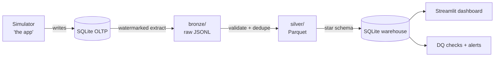

# RideFlow 🚕

A ride-hailing analytics platform built with a **zero-install data engineering stack**:
SQLite (OLTP + warehouse), Parquet data lake (pyarrow), pydantic data contracts,
a custom DAG orchestrator, and a Streamlit dashboard — all pure Python.

## Architecture



## Quickstart

```bash
python -m rideflow.simulator.engine --days 7 --reset   # generate a week of rides
python -m rideflow.orchestrator run                    # bronze → silver → gold
python -m rideflow.orchestrator run                   # again: incremental (near no-op)
python -m rideflow.orchestrator run --backfill         # full reload, identical results
python -m rideflow.orchestrator status                 # run + task history
streamlit run rideflow/dashboard.py                    # explore the data
```

## Pipeline layers

| Layer | Format | Guarantee |
|---|---|---|
| bronze | JSONL, append-only, partitioned by ingestion date | raw & immutable — exactly what the source returned |
| silver | Parquet, compacted per (table, event date) | contract-validated (pydantic), deduped by PK, quarantine for rejects |
| gold | SQLite star schema | PK-upsert facts, rebuilt small dims, joins zone/date/user/driver |

Incremental correctness comes from **watermarks** (high-water mark minus a lookback
window for late-landing rows), a **processed-file ledger** (crashed runs replay
their bronze batches), and **idempotent materialization** (backfills are
byte-identical). Every run, task, attempt, and watermark lives in `data/state.db`.

Status: 🚧 under construction — see `docs/ROADMAP.md`.
