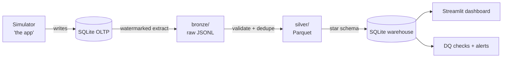

# RideFlow 🚕

A ride-hailing analytics platform built with a **zero-install data engineering stack**:
SQLite (OLTP + warehouse), Parquet data lake (pyarrow), pydantic data contracts,
a custom DAG orchestrator, and a Streamlit dashboard — all pure Python.

## Architecture



## Quickstart

```bash
python -m rideflow.simulator.engine --days 7   # generate a week of rides
python -m rideflow.orchestrator run           # bronze → silver → gold
streamlit run rideflow/dashboard.py            # explore the warehouse
```

Status: 🚧 under construction — see `docs/ROADMAP.md`.
